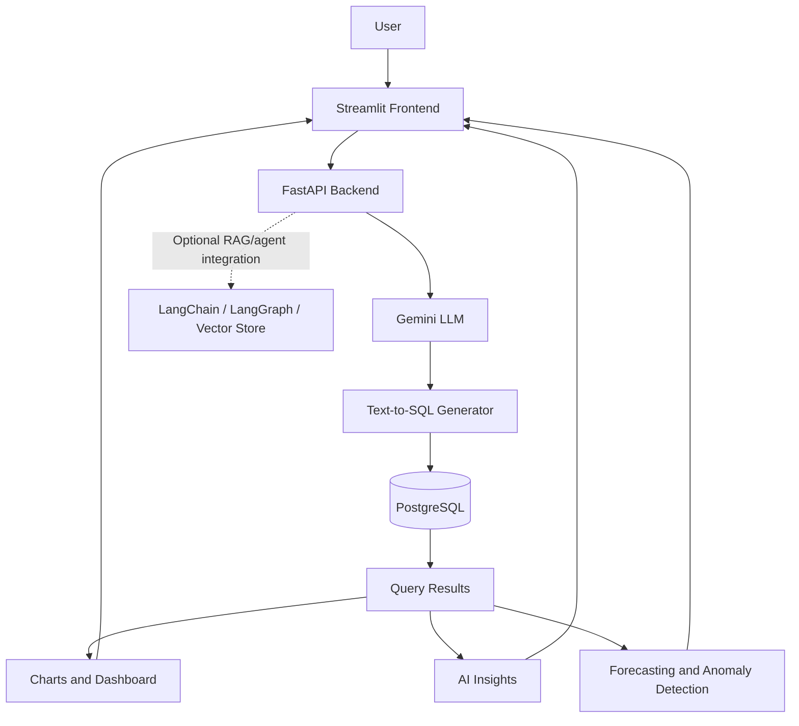

# DataPilot AI

### AI-Powered Business Intelligence & Data Analytics Copilot

DataPilot AI is a Python-based business intelligence application that helps users explore structured business data using natural-language questions. It combines LLM-powered text-to-SQL, PostgreSQL querying, automated visualizations, AI-generated insights, forecasting, anomaly detection, and reporting in a Streamlit interface backed by FastAPI.

> **Project status:** Active development. The repository includes analytics and AI modules; some integrations may require configuration or further testing. AWS deployment is a planned enhancement, not a current deployment claim.

## Problem Statement

Business data is often difficult to explore without SQL, programming, or analytics expertise. Teams may need separate tools to query databases, visualize results, detect unusual trends, forecast performance, and prepare reports. DataPilot AI aims to make these workflows more accessible through a single conversational analytics application.

## Key Capabilities

- **Natural-language to SQL:** Translate business questions into PostgreSQL queries using an LLM.
- **Database analytics:** Execute queries against the Superstore dataset and return tabular results.
- **Automated visualizations:** Generate suitable charts from query results.
- **AI-generated insights:** Summarize findings, trends, risks, and potential recommendations.
- **Forecasting:** Explore future business performance using the forecasting module.
- **Anomaly detection:** Identify potentially unusual patterns in business metrics.
- **Dashboard and reporting:** Present results in Streamlit and support PDF report generation.
- **RAG and agent workflows:** LangChain/LangGraph and document-retrieval integration are part of the project's ongoing development; confirm the corresponding modules in your working branch before describing them as deployed features.

## Technology Stack

| Layer | Technology |
| --- | --- |
| Programming | Python, SQL |
| Frontend | Streamlit |
| Backend/API | FastAPI, Uvicorn |
| Database | PostgreSQL, psycopg2 |
| LLM | Google Gemini API |
| Data analysis | Pandas, NumPy |
| Visualization | Python charting libraries (see `frontend/chart_generator.py`) |
| AI orchestration (integration) | LangChain, LangGraph |
| Retrieval (integration) | Sentence Transformers / Hugging Face embeddings, Chroma |
| Version control | Git, GitHub |
| Planned cloud deployment | AWS EC2, S3, RDS, Bedrock |

## System Architecture



## Project Structure

Based on the current shared project tree:

```text
DataPilot-AI/
├── backend/
│   ├── anomaly_detection.py
│   ├── dashboard_generator.py
│   ├── database.py
│   ├── forecasting.py
│   ├── insight_generator.py
│   ├── llm.py
│   ├── main.py
│   ├── pdf_report.py
│   ├── query_executor.py
│   ├── sql_generator.py
│   ├── test_executor.py
│   ├── test_llm.py
│   └── test_sql.py
├── data/
├── database/
├── frontend/
│   ├── app.py
│   └── chart_generator.py
├── reports/
├── Sample - Superstore.csv
└── README.md
```

Local `.env`, `venv/`, and `__pycache__/` files/folders should not be committed.

## Getting Started

### Prerequisites

- Python 3.10+ (use the version compatible with your installed dependencies)
- PostgreSQL server and a database containing the Superstore data
- Google Gemini API key
- Git

### 1. Clone the repository

```bash
git clone https://github.com/ritish8090/Data-pilot-AI.git
cd Data-pilot-AI
```

### 2. Create a virtual environment

**Windows (PowerShell):**

```powershell
python -m venv venv
.\venv\Scripts\Activate.ps1
```

**macOS/Linux:**

```bash
python3 -m venv venv
source venv/bin/activate
```

### 3. Install dependencies

If the repository contains a dependency manifest, install from it:

```bash
pip install -r requirements.txt
```

If it does not, create a pinned `requirements.txt` from your working environment before sharing the project. Do not assume the example command works until that file is present.

### 4. Configure environment variables

Create `backend/.env` (or use the location expected by your existing configuration code):

```dotenv
# Illustrative names only: verify the exact variable names in database.py and llm.py
DB_HOST=localhost
DB_PORT=5432
DB_NAME=datapilot
DB_USER=your_postgres_user
DB_PASSWORD=your_postgres_password
GEMINI_API_KEY=your_gemini_api_key
```

**Security:** Never commit real API keys, database credentials, or `.env` files. Ensure `.env` is listed in `.gitignore`.

### 5. Prepare the database

Create the PostgreSQL database and import `Sample - Superstore.csv` into the table expected by your SQL generation and query execution modules (commonly `superstore`). Check the actual schema and column names in your code before importing.

### 6. Start the backend

From the project root:

```bash
uvicorn backend.main:app --reload
```

If your code uses imports relative to the `backend` working directory, instead run:

```bash
cd backend
uvicorn main:app --reload
```

The API is typically available at `http://127.0.0.1:8000`, with interactive docs at `/docs` when enabled.

### 7. Start the frontend

In a separate terminal from the project root:

```bash
streamlit run frontend/app.py
```

The Streamlit interface is typically available at `http://localhost:8501`.

## Example Questions

Try asking:

- “Show the top 5 customers by sales.”
- “What is the total revenue by region?”
- “Which category has the highest profit?”
- “Visualize monthly sales trends.”
- “Forecast next month's sales.”
- “Identify unusual sales patterns.”

The accuracy of answers depends on the available dataset, model response, SQL validation, and tool integration.

## Dataset

The project uses the **Sample Superstore** retail dataset for business analytics. It contains order, customer, product, sales, profit, and regional information. Check the dataset's provenance and redistribution permissions before publishing it.

## Roadmap

- [x] Core FastAPI + Streamlit application structure
- [x] LLM, SQL generation, query execution, and insights modules
- [x] Forecasting, anomaly detection, and report-generation modules
- [ ] Verify and document end-to-end tests for all modules
- [ ] Consolidate and document LangChain/LangGraph agent and RAG workflows in the repository
- [ ] Add safe, read-only SQL execution controls and robust error handling
- [ ] Add automated tests and reproducible dependency manifests
- [ ] Containerize the application with Docker
- [ ] Store documents in Amazon S3 and evaluate Bedrock-based RAG
- [ ] Deploy backend/frontend and PostgreSQL on AWS

## Responsible Use & Limitations

- LLM-generated SQL must be validated and executed with **read-only, least-privilege database credentials**.
- AI-generated business explanations can be inaccurate; verify important conclusions against the underlying query results.
- Forecasts are estimates, not guarantees.
- Do not upload sensitive business documents without appropriate access controls and data-handling safeguards.

## Author

**Ritish Roshan Kumar**  
GitHub: [ritish8090](https://github.com/ritish8090)  
Repository: [Data-pilot-AI](https://github.com/ritish8090/Data-pilot-AI)

## Contributing

Issues, suggestions, and pull requests are welcome. Please open an issue to discuss significant changes before submitting a pull request.

---

*DataPilot AI — making business data easier to query, analyze, and understand.*
